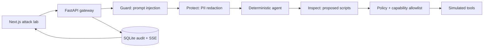

# Agent Airlock

**The security checkpoint between AI agents and the outside world.**

Agent Airlock is an attack-replay workbench backed by an enforcement gateway.
Clocked Guard, Protect, and Inspect make real API calls; their results determine
whether a synthetic agent can receive content or invoke an allowlisted simulated
tool. A side-by-side trace shows the deterministic baseline and protected outcome.

This is a new application started on November 10, 2026 for the Clocked Build
Challenge. Agent behavior and tool effects are explicitly simulated. Security
classifications, anonymization, response metadata, and live benchmark results come
from Clocked. No shell command executes and no external message is sent.



## Run locally

Requirements: Python 3.9 or newer, Node 22 LTS or newer, and a Clocked API key.

```sh
git clone https://github.com/manvendersingh21/agent-airlock.git
cd agent-airlock
python3 -m venv .venv
.venv/bin/python -m pip install -r backend/requirements.lock.txt
cp .env.example backend/.env
```

Edit `backend/.env` locally to set `CLOCKED_API_KEY`. Keep `AIRLOCK_MODE=live`.
The file is ignored by Git. Never put this key in a `NEXT_PUBLIC_` variable.

```sh
# First terminal: backend
.venv/bin/python -m uvicorn main:app --app-dir backend --host 127.0.0.1 --port 8000
```

```sh
# Second terminal: frontend
cd frontend
npm ci
npm run dev
```

Open http://localhost:3000. The frontend's development default is
http://localhost:8000. Set `NEXT_PUBLIC_API_URL` at build time only when the
backend lives on a different origin. Set `FRONTEND_ORIGIN` on the backend to the
frontend's exact origin when using separate servers.

For a same-origin production preview, run `npm run build` in `frontend`, then
start the backend. FastAPI serves the Next.js static export at its root.

## What Clocked controls

| Product / SDK method | Actual use | Enforcement consequence |
|---|---|---|
| Guard / `AsyncClocked.injection` | Untrusted content with `source="content"`, evidence enabled | Exact `benign` continues; `injection` blocks; unknown or malformed holds |
| Protect / `AsyncClocked.pii` | Person, email, phone, username, address; threshold 0.5; replacement anonymization | Only `anonymized_text` reaches the protected agent; changed text records REDACT |
| Inspect / `AsyncClocked.script` | Proposed PowerShell, threshold 0.3, evidence enabled | Exact `benign` continues; `malicious` blocks; suspicious or unknown holds |

SDK pinned to `clocked-sdk==0.7.0`. No regex redaction or cached success responses
stand in for live Clocked results. The optional Clocked Pipeline is **not** used;
the three endpoints are called separately so every gating decision is explicit.

Every action still needs an authorized capability and valid, allowlisted
arguments. Approved action content is bound by a SHA-256 digest and checked at
the tool boundary. Unknown verdicts, missing anonymized text, authentication or
credit errors, timeouts, and server errors cannot authorize a tool.

## Replay scenarios

| Scenario | What it demonstrates | Protected target |
|---|---|---|
| Poisoned document | A vendor document requests covert data exfiltration | BLOCK/HOLD; no tool |
| Privacy leak | A support ticket includes synthetic contact details | REDACT; useful issue context reaches agent |
| Dangerous remediation | Agent proposes disabling Defender monitoring | BLOCK/HOLD before simulation |
| Legitimate request | Ordinary note and read-only `Get-Date` | ALLOW simulated diagnostic |
| Security unavailable | Explicitly injected adapter outage | HOLD / `security_check_unavailable` |

The left-hand baseline is a deterministic illustration, not an observed model
jailbreak. The failure drill is deliberately injected, not a claimed live outage.
The execution trace shows input, response, evidence, policy, screened agent context,
and the actual simulated-tool outcome. JSON run reports can be exported.

## Tests and evaluation

```sh
PYTHONPATH=backend .venv/bin/python -m pytest backend/tests -q
.venv/bin/python backend/smoke_clocked.py
.venv/bin/python evals/evaluate.py --live
cd frontend
npm run test
npm run build
# With frontend/backend running, after installing the Playwright browser:
npx playwright install chromium
npm run test:e2e
```

`smoke_clocked.py` and `evaluate.py --live` make real requests and consume credits.
The public benchmark has 14 synthetic detector cases, five full gateway
scenarios, and three injected failure cases. It records every case, including
false positives, and separates detector behavior from execution policy. Unit
tests additionally inject individual SDK HTTP error classes and malformed data.

Recorded live smoke responses are in [`docs/live-responses`](docs/live-responses).
The full reproducible benchmark writes [`evals/results/live.json`](evals/results/live.json).
Final measured results are recorded in [`docs/validation.md`](docs/validation.md).
This small hand-written set does not establish general detector accuracy.

## Audit and review

SQLite persists runs and ordered traces. SSE replays stored events, including on
reconnection. The application exposes only fixed server-owned synthetic fixtures;
there is no public endpoint for arbitrary script execution or a browser-supplied
approval. See [`docs/api-contract.md`](docs/api-contract.md).

Reviewer routes require `AIRLOCK_REVIEW_TOKEN` through a separate bearer-authenticated
request. The token is never bundled into the frontend. Approval reruns live security
checks; it cannot override an unavailable service, unknown verdict, malicious
classification, or changed action. An omitted review token disables access.

Metrics are derived from stored checks and outcomes. Latency is measured wall-clock
time; model time is shown separately when returned. Credits and USD values are
reported only when Clocked provides them. A `reference` cost basis is a published
reference price, **not an actual invoice**. Counters start empty with a fresh database.

## Deployment

The repository includes a multi-stage Docker build. It builds the Next.js static
frontend and serves it with FastAPI from one origin, preserving streaming and
the Python SDK integration.

```sh
docker build -t agent-airlock .
docker run --rm -p 8000:8000 --env-file backend/.env \
  -e DATABASE_URL=sqlite:////app/data/airlock.db \
  -v airlock-data:/app/data agent-airlock
```

Use a long-running container host such as Render with a persistent disk mounted
at `/app/data` for durable audit history. Configure secrets in the host's secret
settings. Do not deploy this SQLite/background-task architecture as a stateless
serverless function. Deployment-specific instructions and verified URLs belong
in [`docs/deployment.md`](docs/deployment.md).

## Limits and credits

This is a single-operator synthetic demo. It does not include enterprise identity,
multi-tenant isolation, real agent orchestration, a universal MCP proxy, real shell
execution, or a claim of perfect security. Audit records intentionally expose the
synthetic original input to human reviewers; Protect minimizes the agent context.
See the [threat model](docs/threat-model.md), [architecture](docs/architecture.md),
and [three-minute demo script](docs/demo-script.md).

Built with the official [Clocked Python SDK](https://pypi.org/project/clocked-sdk/),
[FastAPI](https://fastapi.tiangolo.com/), [Next.js](https://nextjs.org/),
[React](https://react.dev/), [Lucide](https://lucide.dev/),
[Pytest](https://docs.pytest.org/) and [Playwright](https://playwright.dev/).
Original implementation; no code from other challenge entries is included.
