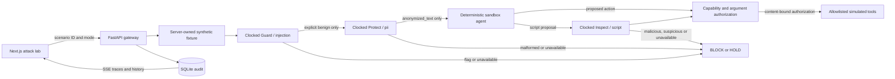

# Architecture

Agent Airlock is a small enforcement gateway with a visual replay workbench.
Clocked provides real security classifications; a trusted Python policy applies
them to synthetic, deterministic agent and tool behavior.

## Boundaries

The browser can select a server fixture and baseline/protected mode. It cannot
submit action arguments, a Clocked verdict, an authorization flag, or a tool
execution request. Pydantic rejects extra request fields. The fixture file and
backend configuration are trusted inputs in this demo.

The baseline is an explicitly labeled deterministic simulation without Clocked.
It illustrates a hypothesized unsafe path; it does not prove a successful attack
against an LLM. Protected mode uses the same synthetic fixture, calls Clocked,
and only simulates a tool if deterministic policy permits it.

Inbound content passes Guard before Protect. Only Protect's returned
`anonymized_text` is assigned to protected agent context. Scripts are inspected
before any simulated execution. A benign classification is still constrained by
the tool/capability allowlist. SHA-256 binds authorization to the proposed action.

No runtime tool spawns a shell, interprets code, reads arbitrary files, or sends a
message to an external recipient. Script strings are sent to Clocked for
classification and, if permitted, are represented as an in-memory simulation.

## Audit and streaming

SQLite stores runs and ordered events. The client uses server-sent events for
progress and can retrieve a full run after completion. A reconnect replays
persisted events using their event IDs. Metrics aggregate actual stored runs and
API metadata, separating baseline simulations from protected decisions.

Raw responses contain only synthetic demonstration data and Clocked's JSON
answer, not authorization headers. Evidence highlighting uses the API's original
code-point offsets. Invalid bounds or mismatched evidence text are shown as raw
evidence instead of being presented as verified highlights.

## Deployment

The Next.js frontend can be statically exported and served by FastAPI from the
same origin. A Docker image builds the frontend with Node and runs only the Python
web server. This avoids cross-origin SSE configuration in the public deployment.
SQLite needs a persistent disk when history must survive a restart. A separate
frontend/backend setup remains supported through `NEXT_PUBLIC_API_URL` and
`FRONTEND_ORIGIN`.
